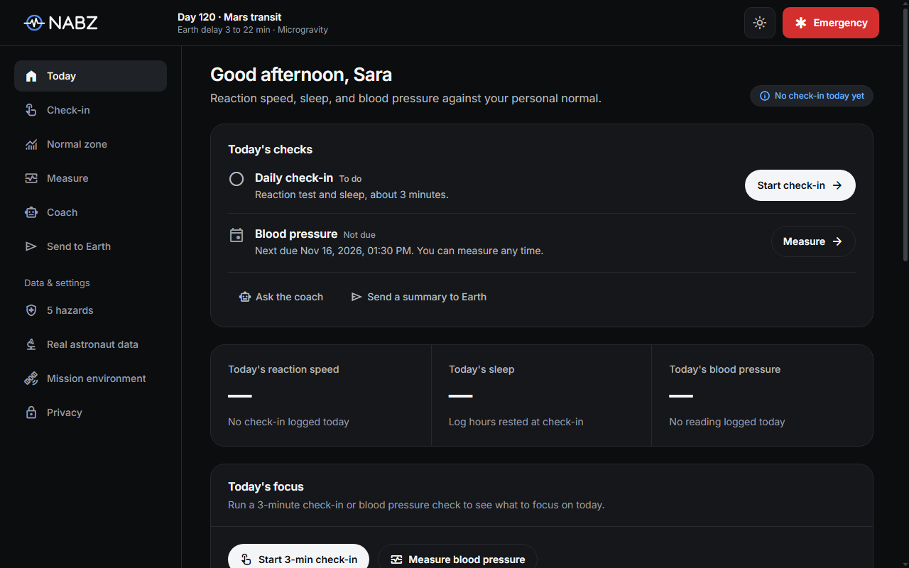
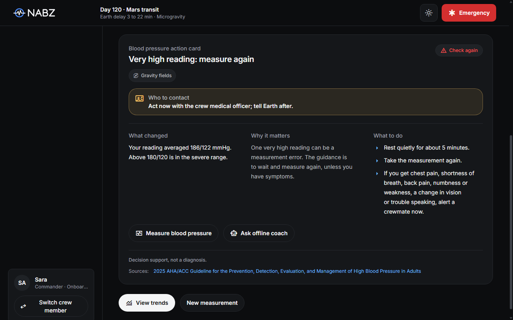
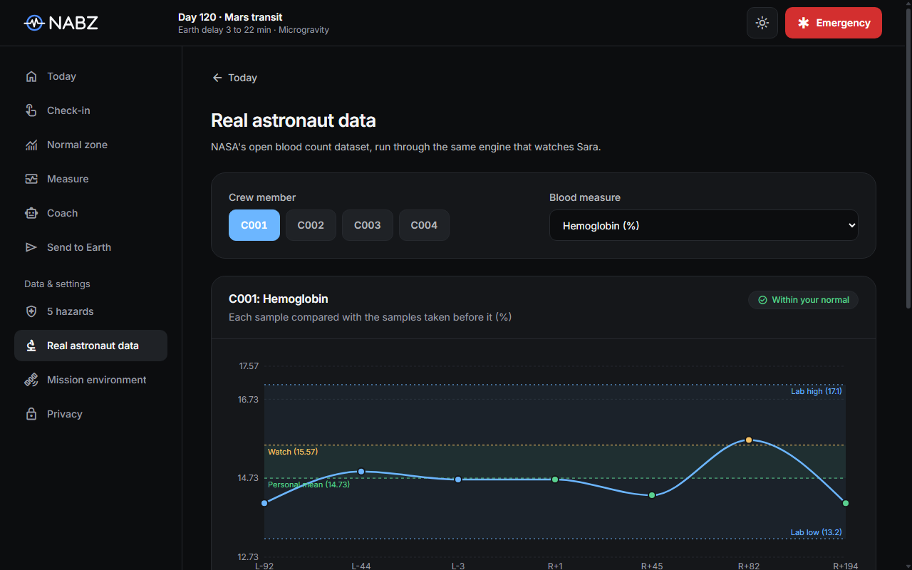
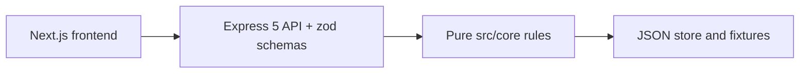

<p align="center">
  <picture>
    <source media="(prefers-color-scheme: dark)" srcset="docs/assets/brand/nabz-logo-on-dark.svg">
    
  </picture>
</p>

<p align="center">
  <b>Health checks and emergency guidance for crews far from help.</b><br>
  An offline app for astronauts on long missions, from the ISS to Mars.
</p>

<p align="center">
  NASA Space Apps Challenge 2026 · Team NOVA TRIO
</p>

<p align="center">
  <a href="https://nabz-drab.vercel.app/"></a>&nbsp;<a href="https://github.com/HamzaKhanBUIC/nabz"></a>&nbsp;<a href="https://drive.google.com/drive/folders/1bNC2ZCBULqHAEtGQfc8hlNCIAtZS_ZU6?usp=sharing"></a>&nbsp;<a href="https://drive.google.com/file/d/1eaZu1KslDCQIQYBzRYQwLof8XGX_RtUY/view"></a>&nbsp;<a href="#run-it-on-your-computer"></a>
</p>

<p align="center">
  <a href="https://github.com/HamzaKhanBUIC/nabz/actions/workflows/ci.yml">
    
  </a>
</p>


> **Halfway to Mars, a crewmate grabs their chest and collapses.** Earth is up to 22 minutes away, each way. Whoever is closest has to act, and they are an astronaut, not a doctor. Nabz (Arabic and Urdu for "pulse") is the app for that moment, and for the ordinary days before it.

## For judges: start here

| What | Link |
|---|---|
| Live app | [nabz-drab.vercel.app](https://nabz-drab.vercel.app) |
| Demo sign-in | Pick **Sara**, code **4120** (also Mateo 7316, Elena 2468, Kenji 9053) |
| Emergency mode, no sign-in | [nabz-drab.vercel.app/emergency](https://nabz-drab.vercel.app/emergency) |
| Real NASA data in the app, no sign-in | [nabz-drab.vercel.app/real-data](https://nabz-drab.vercel.app/real-data) |
| NASA's 5 hazards, no sign-in | [nabz-drab.vercel.app/hazards](https://nabz-drab.vercel.app/hazards) |
| Source code | [github.com/HamzaKhanBUIC/nabz](https://github.com/HamzaKhanBUIC/nabz) |
| Team UX workshop (FigJam export) | [NABZ UX Workshop & Research](https://drive.google.com/file/d/1eaZu1KslDCQIQYBzRYQwLof8XGX_RtUY/view?usp=sharing) |
| NASA dataset | [OSD-569, Inspiration4 crew blood counts](https://osdr.nasa.gov/bio/repo/data/studies/OSD-569) |
| Every number and its source | [research/CHECKS.md](research/CHECKS.md) |
| How AI was used | [AI-USAGE-LOG.md](AI-USAGE-LOG.md) |

**A 2-minute tour:** sign in as Sara → **Check-in** (tap test) → **Measure** a blood pressure of 186/122 to see a red action card → **Real astronaut data** → **Mission environment** (switch from Mars to the ISS and watch who-to-call change) → the red **Emergency** button → *A crewmate* → *CPR in microgravity*.

> [!WARNING]
> **The live API runs on Render's free plan.** It goes to sleep after 15 minutes without visitors, so **the first page can take up to a minute to load**, and an early request may fail. If you see an error, wait a few seconds and refresh. Entries you add online can reset when the free server restarts. For the full, fast experience, [run Nabz on your own computer](#run-it-on-your-computer): it takes about 5 minutes and needs no account or API key.

## What Nabz does

In the default scenario, Commander Sara is on day 120 of a Mars transit where signals to Earth take 3 to 22 minutes each way. Each day she runs a 3-minute reaction and sleep check-in or logs a guided blood pressure measurement. Deterministic rules compare each reading with her own baseline and return an action card with published sources. The Commander can switch the mission to the ISS, the Moon, Mars transit, Mars surface or a remote Earth station; who to call changes, the health limits do not. Emergency procedures open without sign-in, and every core feature works with the network off.

## Screenshots

| Today | Blood pressure action card | Real astronaut data |
|---|---|---|
|  |  |  |

## Features

- **Daily check-in:** 3-minute PVT-B reaction tap test and sleep log with automatic quality checks.
- **Personal normal zone:** Compares each reading against the crew member's own rolling baseline (`building`, `in_zone`, `watch`, `act`) with trend bands.
- **Action cards:** Fixed priority rules choose one card showing what changed, why it matters, what to do, facts used, sources, and a disclaimer.
- **Guided blood pressure:** Walks through resting and seated steps, averages readings, scores against the personal baseline, and schedules retests or alerts.
- **Offline emergency guides:** Nine first-person, one-step-at-a-time procedures that open without signing in. For a crewmate: collapse, CPR in microgravity (110 BPM metronome, Hinkelbein 2020 positions), seizure, low blood sugar. For yourself: bleeding, burn, eye injury or chemical splash, allergic reaction, dizziness or fainting.
- **Coach, routines, reminders, and Earth summary:** Grounded follow-up explanations on existing cards, short health routines, check-up reminders, and confirmed flight-surgeon handoff packages.
- **Crew sign-in:** Crew members sign in with a numeric crew code so each person sees their own records while emergency procedures stay public.
- **Real astronaut data:** Runs the NASA Inspiration4 blood count dataset (OSD-569) through the same baseline engine on `/real-data`.
- **NASA hazards:** Tags every action card with its related NASA hazard and HRP risk ID alongside a 5 hazards reference page.
- **Mission radiation estimate:** Estimates mission dose so far from published daily rates (George et al. 2024) against NASA's 600 mSv career limit, with Curiosity transit context on Mars transit.
- **Crew health for the Medical Officer:** Displays summary cards only for crewmates who turned sharing on, and logs every overview read.
- **Heart rate and blood oxygen:** Resting heart rate (from the cuff pulse) and SpO2 are checked with each blood pressure measurement against sourced cut-offs.
- **Mission environments:** Lets the Commander switch profiles (`ISS`, `Moon`, `Mars transit`, `Mars surface`, `Remote Earth`) to update delay and escalation guidance without changing health thresholds.

## Real data vs simulated data

The Real astronaut data page uses NASA Open Science Data Repository dataset OSD-569 (Inspiration4 crew blood counts; blood counts only). Health thresholds and guidance come from published sources checked in [research/CHECKS.md](research/CHECKS.md): PVT-B reaction scoring and thresholds (Basner et al. 2011; Basner & Dinges 2011), AHA/ACC blood pressure classification and AHA first aid guidance, NASA-STD-3001 (600 mSv career radiation limit), George et al. 2024, Zeitlin et al. 2013, and Hinkelbein 2020. The crew profiles (Sara, Mateo, Elena, Kenji) and their daily readings are synthetic data generated by the seeded simulator (`seed 20261115`). Settings without a clinical source are listed as design choices in [docs/blueprint/03-data-model.md](docs/blueprint/03-data-model.md). Every card states: "Decision support, not a diagnosis."

## Run it on your computer

Recommended if the live site is slow. Everything runs offline once installed: no accounts, no API keys, no network calls.

Prerequisites: [Node.js 24](https://nodejs.org) and [Python 3](https://www.python.org) (for the check script).

```bash
git clone https://github.com/HamzaKhanBUIC/nabz.git
cd nabz
```

1. Run initial setup (installs root dependencies, hooks, and checks the gate):

```powershell
# Windows
./init.ps1
```

```bash
# macOS / Linux
./init.sh
```

2. Install frontend dependencies:

```bash
npm --prefix frontend ci
```

3. Start the Express backend on `http://localhost:8787` (also serves the offline `/dev` test console):

```bash
npm run dev
```

4. In a second terminal, build and start the Next.js frontend on `http://localhost:3000`:

```powershell
# PowerShell
$env:NEXT_PUBLIC_DEMO="1"
npm --prefix frontend run build
npm --prefix frontend run start
```

```bash
# macOS / Linux
NEXT_PUBLIC_DEMO=1 npm --prefix frontend run build
npm --prefix frontend run start
```

Open [http://localhost:3000](http://localhost:3000) and sign in as Sara with code `4120`.

5. Run checks and fixtures:

```bash
python scripts/gate.py         # TypeScript check, ESLint, and Vitest suite
npm --prefix frontend run lint # Frontend ESLint check
npm run simulate               # Regenerate deterministic fixtures in data/fixtures/
npm run simulate -- --check    # Verify fixtures match the seeded output
npm run contract:export        # Export zod schemas to contract/schemas.json
```

Environment variables:
- `PORT`: backend HTTP port (default `8787`, binds `127.0.0.1`).
- `MISSION_NOW`: ISO-8601 mission timestamp override (default `2026-11-15T08:00:00+00:00`).
- `COACH_PROVIDER`: set to `ollama` to use a local Ollama model with automatic offline fallback.
- `NEXT_PUBLIC_API_URL`: backend URL baked into the frontend build when not using `http://localhost:8787`.
- `NEXT_PUBLIC_DEMO`: set to `1` to enable demo helpers in the frontend build.

Demo crew codes (Sara `4120`, Mateo `7316`, Elena `2468`, Kenji `9053`) and walkthrough instructions are in [docs/demo/extras-demo.md](docs/demo/extras-demo.md). Crew codes are stored as scrypt hashes in `data/crew/access.json` and can be updated with `npx tsx tools/crew-access/make.ts sara=4120 mateo=7316 elena=2468 kenji=9053`. Delete `data/runtime/*.json` to reset runtime state back to the seeded fixtures.

## How it works



- **Rules decide, AI only explains:** Scores, zones, red flags, and card selection are computed by rule code in `src/core/`; the optional coach only explains an already-selected card from grounded facts.
- **Offline:** Core check-ins, rules, emergency procedures, NASA OSD-569 parsing, and UI assets run locally without runtime network calls, API keys, or CDNs.
- **Deterministic:** The simulator uses a fixed seed (`20261115`), clocks and data are passed explicitly into core functions, and identical inputs produce the same outputs.

## Project layout

```text
src/core/       Pure TypeScript health rules, baseline engine, cards, and coach grounding
src/schemas/    zod 4 schemas forming the single source of truth for the API contract
src/api/        Express 5 HTTP routes for validation, store access, and responses
src/store/      JSON persistence layer for fixtures, runtime state, and NASA OSD-569 CSV data
src/slots/      Extension interface and provider wrapper for the explanation coach
frontend/       Next.js 16 and React 19 UI rendering API responses
content/        Static JSON for emergencies, BP guide, routines, hazards, environments, and cards
contract/       Exported JSON schemas and validated example request/response payloads
data/           Seeded fixtures (data/fixtures/), raw NASA data (data/nasa/), and crew hashes (data/crew/)
tools/          Seeded simulator (tools/simulate/), /dev test console, and crew-code generator
tests/          Unit, contract, and golden-flow tests verified with Vitest
scripts/        Gate runner (scripts/gate.py) for tsc, eslint, and vitest
docs/           Architecture notes, feature specs, ADRs, API contract, demo guide, and assets
research/       Verified clinical and NASA numbers (research/CHECKS.md) and research briefs
```

## Team

| Name | Role |
|---|---|
| Hamza Imran | Backend and AI |
| Maryam Amjad | Frontend developer |
| Ameni Besbes | UI/UX designer, FigJam UX workshop, pitch |

## Notes

Nabz is a NASA Space Apps Challenge 2026 project built with public NASA data. It is not affiliated with or endorsed by NASA, and uses no NASA logos. AI usage is logged in [AI-USAGE-LOG.md](AI-USAGE-LOG.md).
