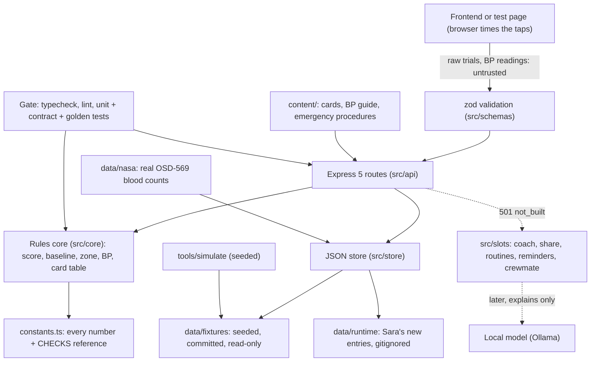

# Architecture

Sara taps through a reaction test, the backend scores it against her own normal, and fixed rules choose the action card. Everything in Must runs offline with no AI.

## Reference repos (borrow / skip)

| Studied (Nov 14, 2026) | Borrow | Skip |
|---|---|---|
| `jspsych/jsPsych` (active) | Trial record: `rtMs` from target onset, `null` for no response. Browser times the tap with `performance.now()`. | The library. It has no PVT plugin and no false-start concept. |
| `gmilab/webpvt` (no licence, stale) | Arm the target with `requestAnimationFrame`; log **every** trial, timeouts included. | Its event protocol; it never sends reaction times. |
| `CacheControl/json-rules-engine` (slow) | Rules as data: `id`, `priority`, `reason`; an output event with params. | The engine: async, throws on a missing fact, order of equal-priority results is unspecified. |
| `synthetichealth/synthea` (active) | One injected seeded generator; seed and injected events stored in the output so tests can check the rules catch them. | Java, exporters, modules. |
| `ts-rest/ts-rest` | Idea only: one endpoint table read by server and tests. | The package: archived Oct 2026, needs Express 4 and zod 3. |
| zod 4 (`z.toJSONSchema`) | Schemas as the contract's source; JSON Schema export with no extra package. | `zod-to-openapi` unless the frontend asks for Swagger. |
| HL7 FHIR Observation | Names: `code`, `value`, `unit`, `effectiveDateTime`, `interpretation`, `referenceRange`. | The rest. We say "FHIR-inspired", never "compliant". |

## Script vs. model split

| Step | Done by | Why |
|---|---|---|
| Score the reaction test | Code | Fixed formulas (Basner 2011) |
| Baseline, z-score, zone | Code | Arithmetic on her own history |
| Choose the action card | Code: priority table, first match wins | Every threshold must be testable |
| Card wording | Code: verified templates, numbers filled in | No invented advice |
| Blood pressure category, red flags, next action | Code | Guideline thresholds |
| Emergency steps | Static verified JSON | Copied from `research/CHECKS.md` |
| 120 days of sample data | Seeded script | Reproducible |
| Follow-up questions (Should) | Model, behind `src/slots/coach` | Free-form language. It reads only the card and its `facts`, and has a fixed "no verified source" reply. |

## Diagram



## Request path (check-in)

1. Browser runs the test and sends raw trials: `{i, isiMs, rtMs | null, early}`.
2. zod rejects a malformed body with a 400. Quality checks flag an implausible session.
3. `core/pvt` scores it. `core/baseline` folds her history in order and gives mean, SD and z.
4. `core/zone` maps z to a zone. `core/cards` runs the rule table and fills the card template.
5. The store appends the entry. The response carries metrics, zone, card and the `facts` the rule used.

## Fallbacks (what happens when something is missing)

| Situation | Behaviour |
|---|---|
| Fewer than 5 valid check-ins | Zone `building`, card `baseline-building`. No z-score is shown. |
| Session fails quality checks | Stored with `qcFlags`, kept out of the baseline, card `checkin-retake`. |
| Baseline SD is 0 | Treated as not ready. |
| `data/runtime` file missing or corrupt | Server starts from fixtures; a corrupt file is renamed `*.corrupt`, never deleted. |
| Network down | No effect. Nothing in Must calls the network. |
| Frontend loses the backend | Emergency procedures come as one versioned bundle so the frontend can cache them. |
| Should feature not built | Its endpoint answers `501` with `{error: {code: "not_built"}}`. |
| Model unavailable (Should) | Coach returns its fixed reply; the card is unchanged. |
| Lost work | Fixtures are committed; every passing feature is committed; pushes to the private repo after Hamza's OK. |

## Directory tree

```
src/core/        constants.ts pvt.ts baseline.ts zone.ts bp.ts cards.ts qc.ts   (pure)
src/schemas/     zod: trial, checkin, bp, card, procedure, trends, mission, error
src/api/         app.ts routes/*.ts stubs.ts
src/store/       fixtures.ts runtime.ts clock.ts
src/slots/       coach/ share/ routines/ reminders/   (README + interface only)
src/server.ts
content/         cards.json bp-guide.json emergency/*.json sources.json
tools/simulate/  seeded generator        tools/console/  our own test page
data/nasa/       OSD-569 CSV + README    data/fixtures/  generated    data/runtime/  ignored
contract/examples/   one request/response JSON per endpoint
tests/unit/  tests/contract/  tests/golden/
docs/api-contract.md  docs/features/  docs/briefs/  docs/blueprint/  docs/adr/
features.json  progress.md  AGENTS.md  scripts/gate.py
```

One npm package. `src/core` has no Node imports, so moving it to a shared browser package later is a folder move.
